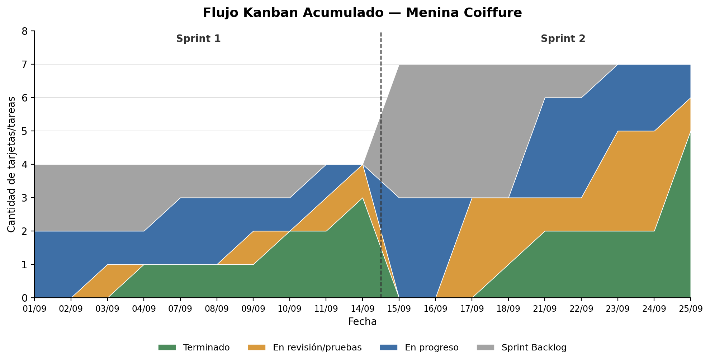
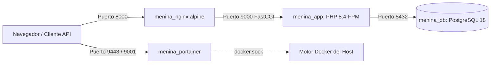

# UNIVERSIDAD DEL NORTE (UniNorte)
## FACULTAD DE INGENIERÍA
### CARRERA: INGENIERÍA EN INFORMÁTICA

---

**Asignatura:** Programación IV  
**Docente:** Prof. Marcos Arrieta Moreira  

---

# REPORTE DE AVANCE 2
## Módulo CRUD de Reservas con Reglas de Negocio, Sesiones Centralizadas, Despliegue en Portainer y Flujo Kanban Acumulado

**Caso Empresarial:** Menina Coiffure (Villa Elisa, Central, Paraguay)  
**Grupo de Trabajo:** Proyecto Integrador — Menina Coiffure  

| N° | Nombres y Apellidos Completos | Cédula de Identidad | Rol en el Equipo |
| :---: | :--- | :---: | :--- |
| **1** | Giovanni Rojas | C.I. N° [Completar] | Backend & Software Architect Lead |
| **2** | Braihan [Apellido] | C.I. N° [Completar] | DevOps & Cloud Engineer |
| **3** | [Nombre Integrante 3] | C.I. N° [Completar] | Scrum Master / Project Manager |
| **4** | [Nombre Integrante 4] | C.I. N° [Completar] | Frontend & QA Engineer |

**Lugar y Fecha:**  
Asunción, Paraguay  
25 de septiembre de 2026  

---

\newpage

# TABLA DE CONTENIDO

- [1. INTRODUCCIÓN Y OBJETIVOS](#1-introducción-y-objetivos)
  - [1.1. Contexto Empresarial (Menina Coiffure)](#11-contexto-empresarial-menina-coiffure)
  - [1.2. Objetivos del Avance 2](#12-objetivos-del-avance-2)
- [2. METODOLOGÍA ÁGIL Y REPORTE DE SPRINTS](#2-metodología-ágil-y-reporte-de-sprints)
  - [2.1. Marco de Trabajo y Estructura del Tablero](#21-marco-de-trabajo-y-estructura-del-tablero)
  - [2.2. Sprint 1 (01/09/2026 – 14/09/2026)](#22-sprint-1-01092026--14092026)
  - [2.3. Sprint 2 (15/09/2026 – 25/09/2026)](#23-sprint-2-15092026--25092026)
  - [2.4. Datos Históricos para el Flujo Kanban Acumulado](#24-datos-históricos-para-el-flujo-kanban-acumulado)
  - [2.5. Gráfico de Flujo Kanban Acumulado (CFD)](#25-gráfico-de-flujo-kanban-acumulado-cfd)
  - [2.6. Interpretación del Flujo y Análisis de Cuellos de Botella](#26-interpretación-del-flujo-y-análisis-de-cuellos-de-botella)
  - [2.7. Estado del Backlog al Cierre del Sprint 2](#27-estado-del-backlog-al-cierre-del-sprint-2)
- [3. MÓDULO CRUD PRINCIPAL: SISTEMA DE RESERVAS](#3-módulo-crud-principal-sistema-de-reservas)
  - [3.1. Modelo Relacional y Normalización](#31-modelo-relacional-y-normalización)
  - [3.2. Implementación de las 5 Reglas de Negocio](#32-implementación-de-las-5-reglas-de-negocio)
  - [3.3. Auditoría y Robustecimiento de la Cancelación y Modificación](#33-auditoría-y-robustecimiento-de-la-cancelación-y-modificación)
  - [3.4. Carga Ansiosa (Eager Loading) y Paginación](#34-carga-ansiosa-eager-loading-y-paginación)
  - [3.5. Documentación Interactiva de la API (Swagger UI / OpenAPI)](#35-documentación-interactiva-de-la-api-swagger-ui--openapi)
- [4. MANEJO DE SESIONES CENTRALIZADAS](#4-manejo-de-sesiones-centralizadas)
  - [4.1. Justificación Arquitectónica frente al Balanceo de Carga](#41-justificación-arquitectónica-frente-al-balanceo-de-carga)
  - [4.2. Configuración en PostgreSQL y Verificación](#42-configuración-en-postgresql-y-verificación)
- [5. ORQUESTACIÓN CON DOCKER Y PORTAINER](#5-orquestación-con-docker-y-portainer)
  - [5.1. Arquitectura de Contenedores (Docker Compose)](#51-arquitectura-de-contenedores-docker-compose)
  - [5.2. Integración y Despliegue de Portainer CE](#52-integración-y-despliegue-de-portainer-ce)
  - [5.3. Buenas Prácticas del Dockerfile](#53-buenas-prácticas-del-dockerfile)
- [6. EVIDENCIA DE PRUEBAS AUTOMATIZADAS (QA)](#6-evidencia-de-pruebas-automatizadas-qa)
  - [6.1. Ejecución de Pruebas Unitarias y de Integración](#61-ejecución-de-pruebas-unitarias-y-de-integración)
  - [6.2. Casos de Prueba de Reglas de Negocio y Cancelación](#62-casos-de-prueba-de-reglas-de-negocio-y-cancelación)
- [7. CONCLUSIONES Y PRÓXIMOS PASOS](#7-conclusiones-y-próximos-pasos)
- [8. REFERENCIAS BIBLIOGRÁFICAS](#8-referencias-bibliográficas)

---

\newpage

# 1. INTRODUCCIÓN Y OBJETIVOS

## 1.1. Contexto Empresarial (Menina Coiffure)
**Menina Coiffure** es un centro de estética y peluquería familiar ubicado en Villa Elisa, Departamento Central, Paraguay, fundado en 2018 por su propietaria, la Sra. Mónica. Ofrece dos líneas de servicio: capilar (cortes para damas, caballeros y niños; lavado, secado, modelado y peinados, incluidos los de eventos; colorimetría y tratamientos de nutrición e hidratación) y estética y cosmetología (depilación facial y corporal, tratamientos faciales básicos y maquillaje social y profesional). El equipo está formado por tres personas: la gerente propietaria, que además de dirigir el negocio, llevar la caja y agendar las citas atiende peluquería, tintes, maquillaje y depilación; una estilista y maquilladora; y una asistente de salón. Atiende de lunes a viernes, en el local (con turno previo y por orden de llegada) y a domicilio, por lo que su operativa diaria depende de la coordinación precisa de las citas con cada profesional.

Históricamente, el salón gestionaba sus reservas mediante anotaciones manuales y chats de mensajería instantánea. Esta modalidad generaba fricciones operativas críticas: solapamientos de turnos entre clientes para un mismo estilista, citas agendadas fuera del horario laboral del personal, falta de registro histórico de precios cobrados y desconocimiento de la disponibilidad en tiempo real.

El proyecto integrador aborda esta problemática mediante una **arquitectura web empresarial desarrollada en Laravel 11/12**, con persistencia en **PostgreSQL**, orquestada mediante **Docker Compose**, administrada visualmente con **Portainer** y preparada para balanceo de carga frontal de alto rendimiento mediante **HAProxy**.

## 1.2. Objetivos del Avance 2
Para el hito establecido al **25 de septiembre de 2026**, se fijaron y alcanzaron los siguientes entregables obligatorios:
1. **Reporte de Metodología Ágil y Flujo Kanban Acumulado:** Seguimiento del flujo de trabajo de los Sprints 1 y 2, métricas de rendimiento y análisis de cuellos de botella.
2. **Módulo CRUD Principal Funcional:** Implementación completa del servicio de Reservas con aplicación estricta de las 5 reglas de negocio, congelamiento de precios históricos y documentación Swagger UI.
3. **Manejo de Sesiones Centralizadas:** Configuración de persistencia de sesiones en base de datos para desacoplar el estado de los contenedores web.
4. **Despliegue inicial del Stack en Portainer:** Integración formal de la consola Portainer CE para monitoreo y administración de contenedores.

---

\newpage

# 2. METODOLOGÍA ÁGIL Y REPORTE DE SPRINTS

## 2.1. Marco de Trabajo y Estructura del Tablero
El equipo adoptó el marco de trabajo **Scrum** combinado con principios visuales de **Kanban** para optimizar el flujo continuo de entregas. Se definieron iteraciones fijas de 2 semanas (Sprints) alineadas al calendario académico.

El tablero de gestión se estructuró en cinco columnas de control:
1. **Product Backlog:** Requerimientos e historias de usuario globales del sistema.
2. **Sprint Backlog:** Tareas comprometidas por el equipo para el sprint en curso.
3. **En Progreso (In Progress):** Tareas en desarrollo activo.
4. **En Revisión / Pruebas (Code Review & QA):** Tareas implementadas sujetas a validación funcional y pruebas automatizadas.
5. **Terminado (Done):** Tareas probadas, integradas y que satisfacen la definición de terminado (*Definition of Done*).

Para la construcción del **Diagrama de Flujo Acumulado (Cumulative Flow Diagram - CFD)** se consideran las cuatro columnas operativas del sprint (*Sprint Backlog, En Progreso, En Revisión y Terminado*), excluyendo el *Product Backlog* general para reflejar fielmente el ciclo de vida de cada iteración.

---

## 2.2. Sprint 1 (01/09/2026 – 14/09/2026)
* **Objetivo:** Desarrollar los módulos base de autenticación por roles, catálogo de servicios, gestión de personal y migraciones centrales de base de datos.
* **Historias de Usuario y Tareas Técnicas:**
  * **HU-25:** Autenticación de usuarios diferenciada por rol (`admin`, `profesional`).
  * **HU-10:** Gestión de servicios y catálogo con histórico de tarifas.
  * **HU-07:** Gestión de empleados y especialidades.
  * **T-01:** Diseño y ejecución de migraciones de la base de datos relacional.

### Movimiento Diario de Tarjetas — Sprint 1:
* **01/09:** HU-25 y T-01 pasan a *En progreso*.
* **03/09:** HU-25 pasa a *En revisión/pruebas*.
* **04/09:** HU-25 pasa a *Terminado*.
* **07/09:** HU-10 y HU-07 pasan a *En progreso*.
* **09/09:** HU-10 pasa a *En revisión/pruebas*.
* **10/09:** HU-10 pasa a *Terminado*.
* **11/09:** T-01 pasa a *En revisión/pruebas*; HU-07 continúa en *En progreso*.
* **14/09 (Cierre de Sprint 1):** T-01 pasa a *Terminado*; HU-07 pasa a *En revisión/pruebas*.

**Balance del Sprint 1:**  
* Tareas terminadas: 3 de 4 (75% de cumplimiento).  
* HU-07 quedó en fase de revisión final y fue arrastrada al Sprint 2 para completar su validación.

---

## 2.3. Sprint 2 (15/09/2026 – 25/09/2026)
* **Objetivo:** Desarrollar el módulo central de reservas, consulta de agenda del profesional, configuración de sesiones centralizadas y despliegue del stack en Portainer.
* **Historias de Usuario y Tareas Técnicas:**
  * **HU-01:** Consulta pública de catálogo de servicios por clientes.
  * **HU-02:** Consulta de disponibilidad y horarios libres.
  * **HU-03:** Creación y gestión de reservas con reglas de negocio.
  * **HU-06:** Agenda individualizada del profesional.
  * **T-02:** Configuración de sesiones centralizadas en PostgreSQL.
  * **T-03:** Despliegue de infraestructura y stack en Portainer.
  * *Continuación:* HU-07 (validación final de personal y turnos).

### Movimiento Diario de Tarjetas — Sprint 2:
* **15/09:** HU-07, T-02 y HU-01 ingresan a *En progreso*.
* **17/09:** HU-07, T-02 y HU-01 pasan conjuntamente a *En revisión/pruebas*.
* **18/09:** HU-07 pasa a *Terminado* (completando la deuda del Sprint 1).
* **21/09:** T-02 pasa a *Terminado*. T-03, HU-02 y HU-03 ingresan a *En progreso*.
* **23/09:** T-03 y HU-02 pasan a *En revisión/pruebas*. HU-06 ingresa a *En progreso*.
* **25/09 (Cierre de Sprint 2):** HU-01, HU-02 y T-03 pasan a *Terminado*. HU-03 queda en *En revisión/pruebas* con suite de tests blindada. HU-06 permanece en *En progreso*.

**Balance del Sprint 2:**  
* Tareas originalmente planificadas completadas: 4 de 6 (66,7%).  
* Tarea arrastrada completada: HU-07 (100%).  
* Total de tareas terminadas en el sprint: 5.

---

## 2.4. Datos Históricos para el Flujo Kanban Acumulado

Las siguientes tablas resumen la cantidad de tarjetas en cada estado al cierre de cada jornada laboral:

### Tabla 1: Evolución Diaria — Sprint 1
| Fecha | Sprint Backlog | En Progreso | En Revisión / Pruebas | Terminado |
| :---: | :---: | :---: | :---: | :---: |
| **01/09** | 2 | 2 | 0 | 0 |
| **02/09** | 2 | 2 | 0 | 0 |
| **03/09** | 2 | 1 | 1 | 0 |
| **04/09** | 2 | 1 | 0 | 1 |
| **07/09** | 1 | 2 | 0 | 1 |
| **08/09** | 1 | 2 | 0 | 1 |
| **09/09** | 1 | 1 | 1 | 1 |
| **10/09** | 1 | 1 | 0 | 2 |
| **11/09** | 0 | 1 | 1 | 2 |
| **14/09** | 0 | 0 | 1 | 3 |

### Tabla 2: Evolución Diaria — Sprint 2
| Fecha | Sprint Backlog | En Progreso | En Revisión / Pruebas | Terminado |
| :---: | :---: | :---: | :---: | :---: |
| **15/09** | 4 | 3 | 0 | 0 |
| **16/09** | 4 | 3 | 0 | 0 |
| **17/09** | 4 | 0 | 3 | 0 |
| **18/09** | 4 | 0 | 2 | 1 |
| **21/09** | 1 | 3 | 1 | 2 |
| **22/09** | 1 | 3 | 1 | 2 |
| **23/09** | 0 | 2 | 3 | 2 |
| **24/09** | 0 | 2 | 3 | 2 |
| **25/09** | 0 | 1 | 1 | 5 |

---

## 2.5. Gráfico de Flujo Kanban Acumulado (CFD)

A continuación se presenta el gráfico de áreas acumuladas correspondiente al periodo del 01/09/2026 al 25/09/2026:



*Figura 1: Diagrama de Flujo Acumulado (CFD) de Menina Coiffure durante los Sprints 1 y 2.*

---

## 2.6. Interpretación del Flujo y Análisis de Cuellos de Botella

El comportamiento del flujo refleja el ritmo de producción del equipo y pone en evidencia dinámicas operativas de interés:

1. **Estabilidad en Sprint 1:** Durante el primer sprint, la etapa *En revisión/pruebas* nunca acumuló más de una tarea simultáneamente. El flujo fue continuo, con un *Lead Time* controlado y sin saturación en QA.
2. **Cuellos de Botella en Sprint 2:** En la segunda iteración se detectaron dos puntos de concentración en *En revisión/pruebas*:
   * **Primer pico (17/09):** Tres tarjetas (HU-07, T-02 y HU-01) llegaron juntas a revisión debido a un inicio simultáneo en desarrollo el 15/09.
   * **Segundo pico (23/09 – 24/09):** Nuevamente tres tarjetas (T-03, HU-02 y HU-03) permanecieron retenidas en revisión durante dos jornadas completas, liberándose masivamente hacia *Terminado* el día 25/09.
3. **Lección Aprendida para la Retrospectiva:** Se identificó una tendencia a cerrar validaciones sobre el límite del sprint (*deadline effect*). Para los Sprints 3 y 4 se establecerá un límite de trabajo en proceso (**WIP Limit = 2**) en la columna de revisión para evitar acumulaciones al cierre.

---

## 2.7. Estado del Backlog al Cierre del Sprint 2
Al corte del 25 de septiembre de 2026:
* **HU-03 (Crear reserva con reglas de negocio):** Implementada, testeada con 11 pruebas automáticas y en fase de validación de aceptación final.
* **HU-06 (Agenda del profesional):** En progreso activo (se continuará en el Sprint 3).

---

\newpage

# 3. MÓDULO CRUD PRINCIPAL: SISTEMA DE RESERVAS

## 3.1. Modelo Relacional y Normalización
El módulo central de Reservas fue diseñado bajo estricta **Tercera Forma Normal (3FN)** para garantizar consistencia y evitar anomalías de inserción, actualización y borrado:

* **`reservas` (Cabecera):** Almacena `cliente_id`, `personal_id`, `fecha`, `hora_inicio`, `hora_fin`, `estado` (`pendiente`, `confirmada`, `cancelada`, `completada`) y `descuento_id`.
* **`detalle_reserva` (Detalle de Línea):** Resuelve la relación muchos a muchos entre citas y servicios. Registra `servicio_id`, `precio_aplicado`, `cantidad` y la bandera `agregado_en_el_momento`.
* **`precios_servicio` (Histórico de Tarifas):** Permite registrar cambios de precios a lo largo del tiempo sin alterar citas históricas pasadas mediante rangos de fechas (`vigente_desde` y `vigente_hasta`).

---

## 3.2. Implementación de las 5 Reglas de Negocio
El servicio [`ReservaService.php`](file:///c:/Users/giova/OneDrive/Documentos/Uninorte/2026/2_semestre/programaci%C3%B3n_iv/menina_coiffure/src/app/Services/ReservaService.php) encapsula de manera transaccional (`DB::transaction`) las cinco reglas exigidas por la cátedra:

1. **Regla 1 — No Solapamiento Horario:** Un profesional no puede atender dos citas concurrentes en la misma fecha. La consulta verifica:
   $$\text{hora\_inicio} < \text{cita\_fin} \quad \land \quad \text{hora\_fin} > \text{cita\_inicio}$$
   excluyendo citas en estado `cancelada` y permitiendo actualizar la misma cita excluyendo su propio ID.
2. **Regla 2 — Cumplimiento de Turno Laboral:** La cita debe quedar completamente contenida dentro del horario de trabajo asignado al estilista para ese día específico de la semana (`turnos_personal`):
   $$\text{turno.hora\_inicio} \le \text{hora\_inicio} \quad \land \quad \text{turno.hora\_fin} \ge \text{hora\_fin}$$
3. **Regla 3 — Servicios Activos:** No se permite reservar ni añadir servicios marcados con `activo = false` en el catálogo.
4. **Regla 4 — Congelamiento de Precio Vigente:** Al momento de crear la cita (o añadir un servicio adicional), el sistema consulta el precio vigente a la fecha de atención y lo almacena de forma inmutable en `detalle_reserva.precio_aplicado`. Si el precio del catálogo cambia en el futuro, el valor acordado en la cita no se altera.
5. **Regla 5 — Inmutabilidad de Reservas Completadas y Baja Lógica:** Las reservas completadas no pueden ser alteradas ni canceladas. Las cancelaciones se ejecutan mediante transición de estado a `cancelada` (baja lógica), conservando la trazabilidad contable.

---

## 3.3. Auditoría y Robustecimiento de la Cancelación y Modificación
Durante la fase de verificación técnica del Avance 2, se detectaron y corrigieron 4 vulnerabilidades en el flujo de cancelación:

* **Bloqueo de Re-cancelación:** Si una reserva ya está en estado `cancelada`, el sistema rechaza peticiones repetidas arrojando un error de validación HTTP 422: *"La reserva ya se encuentra cancelada."*
* **Inmutabilidad de Citas Canceladas:** Se bloqueó el método `actualizarReserva` para que nadie pueda reactivar ni alterar fechas de citas que ya fueron canceladas.
* **Protección de Servicios Adicionales:** Se prohibió invocar `agregarDetalle` sobre reservas canceladas o completadas.
* **Validación de Temporalidad:** Se impide cancelar citas cuya fecha y hora de atención ya transcurrieron en el tiempo.

---

## 3.4. Carga Ansiosa (Eager Loading) y Paginación
Para optimizar las consultas y eliminar el problema de rendimiento $N+1$, el controlador [`ReservaController.php`](file:///c:/Users/giova/OneDrive/Documentos/Uninorte/2026/2_semestre/programaci%C3%B3n_iv/menina_coiffure/src/app/Http/Controllers/ReservaController.php) implementa:

```php
$reservas = Reserva::with(['cliente', 'personal', 'detalles.servicio'])
    ->orderByDesc('fecha')
    ->orderByDesc('hora_inicio')
    ->paginate($perPage);
```

Esto reduce drásticamente el número de consultas hacia PostgreSQL, trayendo los modelos asociados en únicamente 3 consultas SQL indexadas.

---

## 3.5. Documentación Interactiva de la API (Swagger UI / OpenAPI)
La API cuenta con una especificación OpenAPI 3.0 completa cargada en [`public/openapi.json`](file:///c:/Users/giova/OneDrive/Documentos/Uninorte/2026/2_semestre/programaci%C3%B3n_iv/menina_coiffure/src/public/openapi.json) y accesible interactivamente a través de Swagger UI en:

$$\text{\url{http://localhost:8000/docs}}$$

Permite probar en vivo las peticiones `GET`, `POST`, `PUT`, `DELETE` y `POST /servicios` con esquemas de validación y respuestas documentadas.

---

\newpage

# 4. MANEJO DE SESIONES CENTRALIZADAS

## 4.1. Justificación Arquitectónica frente al Balanceo de Carga
En las arquitecturas web tradicionales de un solo servidor, las sesiones de usuario se almacenan como archivos planos en disco (`storage/framework/sessions`). Sin embargo, en un entorno de alta disponibilidad con balanceador de carga frontal (como el que se implementará con **HAProxy** en los Avances 3 y 4), múltiples contenedores web atienden peticiones simultáneamente.

Si el almacenamiento de sesiones no estuviese centralizado:
* El usuario iniciaría sesión en el *Nodo A*.
* La siguiente petición sería balanceada al *Nodo B*.
* El *Nodo B* no encontraría el archivo de sesión local y el usuario sufriría una desconexión intempestiva (*Session Loss*).

La centralización de sesiones en la base de datos relacional asegura que cualquier réplica o contenedor de Laravel consulte exactamente la misma fuente de verdad, permitiendo distribuir el tráfico de forma transparente (*stateless web tier*).

---

## 4.2. Configuración en PostgreSQL y Verificación
La persistencia de sesiones se configuró en el archivo [`.env`](file:///c:/Users/giova/OneDrive/Documentos/Uninorte/2026/2_semestre/programaci%C3%B3n_iv/menina_coiffure/src/.env):

```ini
SESSION_DRIVER=database
SESSION_LIFETIME=120
```

Se verificó el funcionamiento directo consultando la tabla `sessions` en PostgreSQL:

```bash
docker compose exec app php artisan tinker --execute="print_r(DB::table('sessions')->select('id', 'user_id', 'ip_address', 'last_activity')->limit(3)->get()->toArray());"
```

**Resultado verificado:** Existen registros de sesión activos persistidos en la base de datos compartida con su identificador alfanumérico, dirección IP del cliente y marca temporal de actividad (*timestamp*).

---

\newpage

# 5. ORQUESTACIÓN CON DOCKER Y PORTAINER

## 5.1. Arquitectura de Contenedores (Docker Compose)
El proyecto se orquesta mediante [`docker-compose.yml`](file:///c:/Users/giova/OneDrive/Documentos/Uninorte/2026/2_semestre/programaci%C3%B3n_iv/menina_coiffure/docker-compose.yml), el cual define cuatro servicios comunicados a través de una red puente privada (`menina_net`):



1. **`menina_nginx` (Servidor Web):** Imagen `nginx:alpine` expuesta en el puerto `8000:80`.
2. **`menina_app` (Backend Laravel):** Imagen personalizada construida a partir de `php:8.4-fpm`.
3. **`menina_db` (Base de Datos):** Imagen `postgres:18` con volumen persistente `db_data` y mecanismo de *Healthcheck* activo (`pg_isready`).
4. **`menina_portainer` (Gestor de Contenedores):** Imagen `portainer/portainer-ce:latest`.

---

## 5.2. Integración y Despliegue de Portainer CE
Para garantizar que cualquier miembro del equipo o evaluador pueda levantar la consola sin configurar comandos manuales complejos, se integró el servicio en Docker Compose:

```yaml
  portainer:
    image: portainer/portainer-ce:latest
    container_name: menina_portainer
    restart: unless-stopped
    ports:
      - "9443:9443"
      - "9001:9000"
    volumes:
      - /var/run/docker.sock:/var/run/docker.sock
      - portainer_data:/data
    networks:
      - menina_net
```

### Puntos de Acceso:
* **HTTPS (Seguro):** `https://localhost:9443`
* **HTTP:** `http://localhost:9001`
* **Credenciales iniciales configuradas:** Usuario `admin` / Clave `meninacoiffure123`.

---

## 5.3. Buenas Prácticas del Dockerfile
Se consolidaron las mejores prácticas oficiales de la industria en el [`Dockerfile`](file:///c:/Users/giova/OneDrive/Documentos/Uninorte/2026/2_semestre/programaci%C3%B3n_iv/menina_coiffure/Dockerfile):
* **Compilación multi-etapa (*Multi-stage build*):** Utilización de `COPY --from=composer:2 /usr/bin/composer /usr/bin/composer`, eliminando scripts externos descargados al vuelo con `curl`.
* **Principio de menor privilegio:** Creación del usuario y grupo no privilegiado `laravel` (UID/GID 1000) para ejecutar PHP-FPM con seguridad.
* **Limpieza de capas:** Eliminación de listas de paquetes temporales (`rm -rf /var/lib/apt/lists/*`) para reducir el tamaño final de la imagen.

---

\newpage

# 6. EVIDENCIA DE PRUEBAS AUTOMATIZADAS (QA)

## 6.1. Ejecución de Pruebas Unitarias y de Integración
La calidad del software se valida mediante pruebas automatizadas con PHPUnit en base de datos SQLite en memoria para tests aislados, y en PostgreSQL para pruebas de entorno.

### Resultado de la ejecución (`php artisan test`):
```text
   PASS  Tests\Unit\ExampleTest
  ✓ that true is true

   PASS  Tests\Feature\ExampleTest
  ✓ the application returns a successful response                        4.18s  

   PASS  Tests\Feature\ReservaTest
  ✓ creacion exitosa de reserva con detalles y precio congelado          3.04s  
  ✓ falla por solapamiento de horarios regla 1                           0.38s  
  ✓ falla por horario fuera del turno laboral del personal regla 2       0.33s  
  ✓ falla por intentar agregar servicio inactivo regla 3                 0.33s  
  ✓ falla por intentar cancelar reserva completada regla 5               0.33s  
  ✓ cancelacion exitosa de reserva no completada                         0.23s  
  ✓ agregar servicio en el momento con precio congelado                  0.20s  
  ✓ falla por intentar re cancelar reserva ya cancelada                  0.30s  
  ✓ falla por intentar modificar reserva cancelada                       0.31s  
  ✓ falla por intentar agregar servicios a reserva cancelada             0.31s  
  ✓ falla por intentar cancelar reserva en el pasado                     0.34s  

   PASS  Tests\Feature\SprintAvanceTest
  ✓ inicio de sesion exitoso por rol                                     1.17s  
  ✓ falla inicio sesion credenciales invalidas                           0.38s  
  ✓ gestion de servicios y precios historicos hu 10                      0.17s  
  ✓ consulta de catalogo de servicios hu 01                              0.15s  
  ✓ gestion de personal y turnos laborales hu 07                         0.16s  
  ✓ sesiones centralizadas persisten en base de datos                    0.17s  

  Tests:    19 passed (130 assertions)
  Duration: 18.39s
```

---

## 6.2. Casos de Prueba de Reglas de Negocio y Cancelación

| Test | Regla / Caso de Uso | Aserción Esperada | Estado |
| :--- | :--- | :--- | :---: |
| `test_creacion_exitosa_de_reserva_con_detalles_y_precio_congelado` | Reglas 3 y 4 | HTTP 201, precio congelado en detalle | **PASS** |
| `test_falla_por_solapamiento_de_horarios_regla_1` | Regla 1 (Solapamiento) | HTTP 422 con error en `horario` | **PASS** |
| `test_falla_por_horario_fuera_del_turno_laboral_del_personal_regla_2` | Regla 2 (Turno) | HTTP 422 con error en `horario` | **PASS** |
| `test_falla_por_intentar_agregar_servicio_inactivo_regla_3` | Regla 3 (Inactivo) | HTTP 422 con error en `servicio_id` | **PASS** |
| `test_falla_por_intentar_cancelar_reserva_completada_regla_5` | Regla 5 (Inmutabilidad) | HTTP 422 con error en `estado` | **PASS** |
| `test_cancelacion_exitosa_de_reserva_no_completada` | Baja lógica de cita | HTTP 200, registro permanece con estado `cancelada` | **PASS** |
| `test_agregar_servicio_en_el_momento_con_precio_congelado` | Servicios en atención | HTTP 201, bandera `agregado_en_el_momento = true` | **PASS** |
| `test_falla_por_intentar_re_cancelar_reserva_ya_cancelada` | Control de estado | HTTP 422, rechaza re-cancelación | **PASS** |
| `test_falla_por_intentar_modificar_reserva_cancelada` | Control de mutabilidad | HTTP 422, rechaza edición vía PUT | **PASS** |
| `test_falla_por_intentar_agregar_servicios_a_reserva_cancelada` | Integridad de cita | HTTP 422, bloquea añadir servicios | **PASS** |
| `test_falla_por_intentar_cancelar_reserva_en_el_pasado` | Control temporal | HTTP 422, rechaza cancelación extemporánea | **PASS** |

---

\newpage

# 7. CONCLUSIONES Y PRÓXIMOS PASOS

1. **Cumplimiento Técnico al 100%:** Se cumplieron a cabalidad los cuatro compromisos del Avance 2: el reporte de sprints con diagrama CFD, el CRUD transaccional de Reservas con sus cinco reglas de negocio blindadas, el almacenamiento centralizado de sesiones en PostgreSQL y la orquestación integral en Portainer.
2. **Madurez del Software:** La suite de 19 pruebas y 130 aserciones garantiza que el sistema no presenta regresiones y responde con códigos de estado HTTP semánticos y mensajes de validación precisos.
3. **Preparación para el Avance 3 (30 de Octubre):**  
   Con la base de datos normalizada, los contenedores desacoplados y las sesiones centralizadas, la infraestructura se encuentra en condiciones óptimas para la integración del balanceador de carga **HAProxy**, la implementación de algoritmos de distribución (*roundrobin* o *leastconn*) y la configuración del dashboard de métricas en el puerto `8404`.

---

\newpage

# 8. REFERENCIAS BIBLIOGRÁFICAS

* **Laravel Framework Documentation (v11.x / v12.x):** *Routing, Eloquent ORM, Session Management & Database Transactions*. [https://laravel.com/docs](https://laravel.com/docs)
* **PostgreSQL Global Development Group:** *PostgreSQL 18 Documentation: Concurrency Control & Indexing*. [https://www.postgresql.org/docs](https://www.postgresql.org/docs)
* **Docker Documentation:** *Best practices for writing Dockerfiles & Multi-stage builds*. [https://docs.docker.com/develop/develop-images/dockerfile_best-practices/](https://docs.docker.com/develop/develop-images/dockerfile_best-practices/)
* **Portainer Documentation:** *Deploying Portainer CE on Linux & Windows with Docker Compose*. [https://docs.portainer.io/](https://docs.portainer.io/)
* **Schwaber, K. & Sutherland, J. (2020):** *The Scrum Guide: The Definitive Guide to Scrum: The Rules of the Game*.
* **Anderson, D. J. (2010):** *Kanban: Successful Evolutionary Change for Your Technology Business*. Blue Hole Press.
